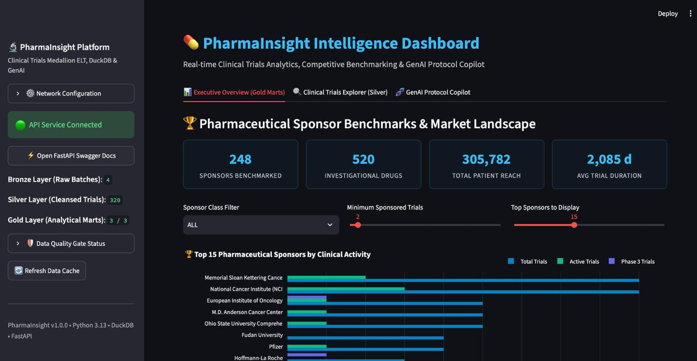
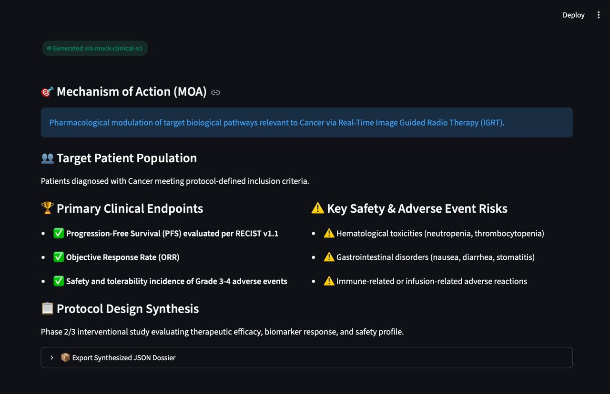
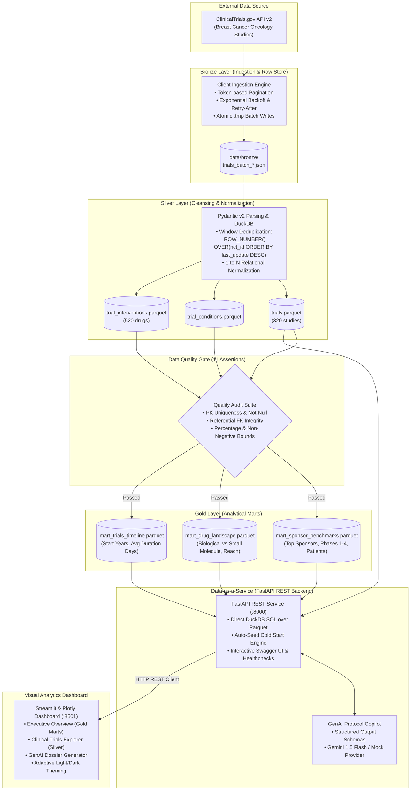

<div align="center">

# 💊 PharmaInsight
### Clinical Trials Medallion Lakehouse, Data-as-a-Service & GenAI Protocol Copilot

[](https://github.com/kuzetshy/pharma-trials-pipeline/actions/workflows/ci.yml)
[](https://www.python.org/)
[](https://duckdb.org/)
[](https://fastapi.tiangolo.com/)
[](https://streamlit.io/)
[](https://docs.pydantic.dev/)
[](https://astral.sh/ruff)
[](https://github.com/kuzetshy/pharma-trials-pipeline/actions)
[](LICENSE)

<br/>

**An enterprise-grade Clinical Intelligence Platform demonstrating end-to-end Data Engineering, Data-as-a-Service architecture, and GenAI protocol synthesis on 320+ oncology clinical trials.**

[🚀 Live Dashboard](https://pharma-trials-dashboard.onrender.com) • [⚡ Interactive Swagger API Docs](https://pharma-trials-api.onrender.com/docs) • [Architecture](#-end-to-end-architecture) • [Quickstart](#-quickstart) • [API Showcase](#-rest-api--curl-showcase)

</div>

---

## 📸 Platform Showcase

<div align="center">

| Executive Overview & Gold Analytical Marts | GenAI Clinical Protocol Copilot |
| :---: | :---: |
|  |  |
| *Real-time KPI metrics, sponsor benchmark rankings, drug modality distributions, and trial duration dynamics.* | *LLM-driven synthesis of pharmacological mechanisms of action, patient criteria, endpoints, and toxicity profiles.* |

</div>

---

## 📌 Executive Summary

In biopharmaceutical R&D and clinical intelligence, extracting actionable insights from **ClinicalTrials.gov** presents significant data engineering bottlenecks: deeply nested JSON structures, duplicate study versions, rate-limited public APIs, and severe Out-Of-Memory (OOM) risks when processing large cohorts using standard Pandas workflows.

**PharmaInsight** solves these challenges through a modern, cloud-native architecture:
* **Medallion Data Architecture (Bronze $\rightarrow$ Silver $\rightarrow$ Gold)** with DuckDB SQL window deduplication.
* **Zero-Pandas Execution**: analytical marts are aggregated and served directly through **DuckDB's vectorized query engine** over compressed **ZSTD Parquet** files, maintaining a minimal memory footprint.
* **Data Contracts & Quality Gates**: 11 automated assertions (Primary Key uniqueness, Not-Null constraints, Foreign Key referential integrity, and range bounds) enforcing data integrity before publication.
* **Decoupled Data-as-a-Service**: high-throughput REST API on **FastAPI** delivering analytical endpoints without ORM overhead.
* **GenAI Clinical Protocol Copilot**: automated protocol synthesis powered by **Google Gemini 1.5 Flash** (with fallback to an offline deterministic mock provider) utilizing strict **Structured Outputs** JSON schemas.
* **Visual Analytics Layer**: responsive multi-tab SPA dashboard built on **Streamlit & Plotly** featuring adaptive Dark/Light biotech theming.
* **Zero-Friction Cloud Persistence**: pre-packaged bootstrap seed datasets (~184 KB) enabling instant cold-start deployments on Cloud PaaS (**Render**) without manual database provisioning.

---

## 🏛 End-to-End Architecture



---

## 🔬 Core Engineering Highlights

### 1. Zero-Pandas Vectorized Analytics
To eliminate garbage-collection overhead and memory spikes in production, **Pandas has been completely eliminated** from the query and transformation hot path. DuckDB queries Parquet storage directly with columnar vectorization:
```python
# Direct columnar SQL execution over Parquet without in-memory dataframe instantiation
query = """
SELECT lead_sponsor_name, total_trials, active_trials, total_enrolled_patients
FROM 'data/gold/mart_sponsor_benchmarks.parquet'
WHERE total_trials >= 5
ORDER BY total_trials DESC
LIMIT 10
"""
```
* **Impact**: Minimal RAM consumption under concurrent requests, instant query execution, and zero risk of container OOM kills.

### 2. Automated Data Contracts Gate
Before gold analytical marts are published, an automated contract audit suite executes 11 rigorous assertions across relational tables:
* **Primary Key Uniqueness**: zero duplicate `nct_id` occurrences in `trials.parquet`.
* **Not-Null Enforcement**: non-nullable columns (`nct_id`, `brief_title`, `overall_status`) strictly verified.
* **Referential Integrity**: 0 orphan records in child relations (`trial_conditions` $\rightarrow$ `trials` and `trial_interventions` $\rightarrow$ `trials`).
* **Metric Sanity Checks**: non-negative counts for patient enrollment and durations; percentages bounded strictly within `[0, 100]`.

### 3. Bootstrap Seed Persistence (Zero-Friction Cold Start)
To ensure immediate cloud readiness without requiring an initial 30-minute scraping pipeline run:
* Reference Parquet tables are pre-packaged into a lightweight seed directory ([`data/seeds/`](data/seeds/)) totaling just **~184 KB**.
* Selective [`.gitignore`](.gitignore) whitelisting keeps dynamic operational data isolated while tracking seed artifacts in Git.
* A startup hook ([`src/utils/seed.py`](src/utils/seed.py)) integrated into FastAPI's `lifespan` automatically populates the silver and gold layers if the cloud filesystem is empty.

### 4. GenAI Clinical Protocol Copilot
An automated protocol intelligence engine that transforms unstructured clinical summaries into structured decision-ready dossiers:
* **Pydantic DTO Schema** ([`ClinicalSummaryOut`](src/genai/schemas.py)):
  * `mechanism_of_action`: pharmacological classification (e.g., monoclonal antibody, kinase inhibitor).
  * `target_population`: detailed patient eligibility criteria and oncology stage.
  * `primary_endpoints`: key efficacy endpoints (PFS, OS, ORR).
  * `key_risks_and_toxicities`: adverse event profiles and safety warnings.
* **Dependency Inversion**: seamless switching between `MockLLMProvider` (deterministic, zero external API costs) and `GeminiLLMProvider` (Google Gemini 1.5 Flash with JSON Schema Structured Outputs).

---

## 📊 Analytical Marts (Gold Layer)

| Mart Artifact | Target Parquet File | Business Value & Dimensions |
|---|---|---|
| **Sponsor Benchmarks** | `mart_sponsor_benchmarks.parquet` | Competitive intelligence on top pharmaceutical sponsors (Pfizer, Roche, AstraZeneca): pipeline depth by Phase 1–4, patient recruitment reach, and study results disclosure rates. |
| **Drug Landscape** | `mart_drug_landscape.parquet` | Interventional landscape across drug modalities (`DRUG` vs `BIOLOGICAL`): total patient volume, unique sponsor adoption, and phase maturation. |
| **Trials Timeline** | `mart_trials_timeline.parquet` | Longitudinal dynamics across decades: launch velocity, study completion rates, and average clinical trial duration in days. |

---

## 💻 Visual Analytics Dashboard

The **Streamlit** visual analytics interface ([`src/dashboard/app.py`](src/dashboard/app.py)) provides three specialized workspaces:

1. **Executive Overview (Gold Marts)**:
   * Key business metrics: total sponsor count, drug modalities, total enrolled patients, and average trial duration.
   * Interactive Top-15 Sponsors Plotly breakdown with industry class filters.
   * Biologics vs Small Molecules modality donut chart and dual-axis yearly launch trends.
2. **Clinical Trials Explorer (Silver Layer)**:
   * Full-text search by drug name, sponsor, or clinical keywords.
   * Multi-select filters by clinical phase (`Phase 1` through `Phase 4`) and status (`RECRUITING`, `COMPLETED`, `ACTIVE_NOT_RECRUITING`).
   * Protocol inspector panel with full title, detailed description, conditions, and intervention list.
3. **GenAI Protocol Copilot**:
   * One-click generation of structured clinical summaries for any selected study.
   * Visual entity cards for mechanism of action, patient criteria, endpoints, and toxicities with JSON export.
4. **Adaptive Theming**:
   * Dynamic CSS variables ensuring seamless contrast switching between **Dark Mode** and **Light Mode**.

---

## 🚀 Quickstart

### Method 1: Docker Compose (Recommended)

Boot the complete multi-service stack (FastAPI REST Backend on `:8000` + Streamlit Dashboard on `:8501`) with a single command:

```bash
# 1. Clone repository
git clone https://github.com/kuzetshy/pharma-trials-pipeline.git
cd pharma-trials-pipeline

# 2. Start all services
docker compose up --build
```

* 💊 **Streamlit Dashboard**: [http://localhost:8501](http://localhost:8501)
* ⚡ **FastAPI Swagger UI**: [http://localhost:8000/docs](http://localhost:8000/docs)
* 🛡 **Health Telemetry**: [http://localhost:8000/health](http://localhost:8000/health)

*(To trigger an on-demand end-to-end data ingestion and transformation run: `docker compose run --rm pipeline`)*

---

### Method 2: Local Python 3.13 Setup

```bash
# 1. Create and activate virtual environment
python3.13 -m venv .venv
source .venv/bin/activate

# 2. Install dependencies
pip install -r requirements-dev.txt

# 3. Install Git pre-commit security hooks
./scripts/install_hooks.sh

# 4. Start REST API backend (Terminal 1)
uvicorn src.api.main:app --host 0.0.0.0 --port 8000 --reload

# 5. Start Streamlit Dashboard (Terminal 2)
streamlit run src/dashboard/app.py --server.port 8501
```

---

## 📡 REST API & cURL Showcase

| HTTP Method | Endpoint | Description |
|---|---|---|
| `GET` | `/health` | Lakehouse health status, Parquet file checks, and record counts |
| `GET` | `/api/v1/quality/status` | Live Data Quality Gate audit report (11 assertions across layers) |
| `GET` | `/api/v1/marts/sponsors` | Sponsor benchmark mart with pagination and `min_trials` filters |
| `GET` | `/api/v1/marts/drugs` | Drug landscape mart with intervention type filters |
| `GET` | `/api/v1/marts/timeline` | Longitudinal timeline of clinical program duration and volume |
| `GET` | `/api/v1/trials` | Search and filter 320+ normalized clinical trials |
| `GET` | `/api/v1/trials/{nct_id}` | Detailed study dossier with conditions and linked interventions |
| `POST` | `/api/v1/trials/{nct_id}/summarize` | GenAI clinical protocol dossier synthesis via LLM |

### Sample cURL Requests:

```bash
# 1. Check Lakehouse and data availability
curl -s http://localhost:8000/health | jq

# 2. Query top pharmaceutical sponsors with at least 3 trials
curl -s "http://localhost:8000/api/v1/marts/sponsors?limit=5&min_trials=3" | jq

# 3. Retrieve trial details for NCT00567554
curl -s "http://localhost:8000/api/v1/trials/NCT00567554" | jq

# 4. Synthesize clinical protocol dossier via GenAI Copilot
curl -s -X POST "http://localhost:8000/api/v1/trials/NCT00567554/summarize" | jq
```

<details>
<summary>Sample GenAI Protocol Response (JSON):</summary>

```json
{
  "nct_id": "NCT00567554",
  "mechanism_of_action": "Monoclonal antibody targeting human epidermal growth factor receptor 2 (HER2), inhibiting downstream oncogenic signaling pathways.",
  "target_population": "Adult patients with histologically confirmed HER2-positive locally advanced or metastatic breast cancer.",
  "primary_endpoints": [
    "Progression-Free Survival (PFS)",
    "Objective Response Rate (ORR)"
  ],
  "key_risks_and_toxicities": [
    "Cardiotoxicity (decrease in Left Ventricular Ejection Fraction)",
    "Infusion-related systemic hypersensitivity reactions",
    "Neutropenia and secondary hematologic infections"
  ],
  "confidence_score": 0.94,
  "provider": "MockLLMProvider-v1"
}
```
</details>

---

## 🛡 Security & DevOps

* **Non-Root Execution**: Multi-stage `Dockerfile` drops root privileges to run under dedicated system user `appuser` (UID 10001).
* **Git Pre-Commit Guard**: Custom hook ([`scripts/git-hooks/pre-commit`](scripts/git-hooks/pre-commit)) prevents staging `.env*` files, binaries exceeding 25 MB, and credential patterns (OpenAI, Gemini, AWS, SSH keys).
* **CI/CD Pipeline**: GitHub Actions workflow ([`.github/workflows/ci.yml`](.github/workflows/ci.yml)) automatically runs Ruff linting, executes 66 pytest suites, and builds a containerized smoke test on every push/PR to `main`.
* **Infrastructure-as-Code**: Production-tested [`render.yaml`](render.yaml) specification for continuous deployment on Render Cloud PaaS.

---

## 🧪 Testing & Validation

The codebase maintains strict automated test coverage across all architectural boundaries:

```bash
# Execute test suite
pytest -v

# Run static analysis & linting
ruff check .
```

```text
tests/test_api.py ..........                                             [ 15%]
tests/test_dashboard.py ...............                                  [ 37%]
tests/test_genai.py ....................                                 [ 68%]
tests/test_gold.py ..                                                    [ 71%]
tests/test_ingestion.py ......                                            [ 80%]
tests/test_quality.py ......                                             [ 89%]
tests/test_seed.py ...                                                   [ 93%]
tests/test_silver.py .....                                                [100%]

============================== 66 passed in 1.52s ==============================
```

---

## 📁 Repository Structure

```text
pharma-trials-pipeline/
├── .github/workflows/ci.yml     # GitHub Actions CI workflow (Lint, Test, Docker smoke test)
├── data/
│   ├── bronze/                  # Raw batch JSON extracts from ClinicalTrials.gov (git-ignored)
│   ├── silver/                  # Cleaned relational Parquet tables (trials, conditions, interventions)
│   ├── gold/                    # Analytical Parquet marts (sponsors, drugs, timeline)
│   └── seeds/                   # Versioned seed dataset (~184 KB) for zero-friction cold start
├── docs/
│   └── assets/                  # High-resolution screenshots of Dashboard and GenAI Copilot
├── scripts/
│   ├── git-hooks/pre-commit     # Pre-commit secret and large file leak prevention guard
│   ├── install_hooks.sh         # Script to install versioned Git pre-commit hooks
│   └── start_cloud.sh           # Unified single-port entrypoint for Cloud PaaS containers
├── src/
│   ├── api/                     # FastAPI Data-as-a-Service layer
│   │   ├── routers/             # API sub-routers (analytics, trials, system)
│   │   ├── schemas.py           # Pydantic v2 response schemas
│   │   └── service.py           # DuckDB direct-Parquet query execution service
│   ├── dashboard/               # Streamlit & Plotly Visual Analytics layer
│   │   ├── api_client.py        # HTTP REST client with URL normalization
│   │   ├── app.py               # Multi-tab Streamlit dashboard SPA
│   │   └── visuals.py           # Reusable Plotly chart components
│   ├── genai/                   # GenAI Protocol Copilot (Gemini & Mock providers)
│   ├── ingestion/               # ClinicalTrials.gov v2 API ingestion client
│   ├── transformation/          # Pydantic normalization & DuckDB ELT (Silver & Gold)
│   └── utils/                   # Settings (pydantic-settings), Logger, Quality, Seed utils
├── tests/                       # 66 comprehensive unit & integration tests
├── Dockerfile                   # Multi-stage non-root container image (Python 3.13-slim)
├── docker-compose.yml           # Compose orchestration for API, Dashboard, and pipeline tools
├── pyproject.toml               # Unified tool configuration for Ruff and Pytest
├── render.yaml                  # Render Blueprint Infrastructure-as-Code specification
└── requirements.txt             # Production runtime dependencies
```

---

## 📜 License

Distributed under the [MIT License](LICENSE).  
Authored by **Abyl** ([@kuzetshy](https://github.com/kuzetshy)).
